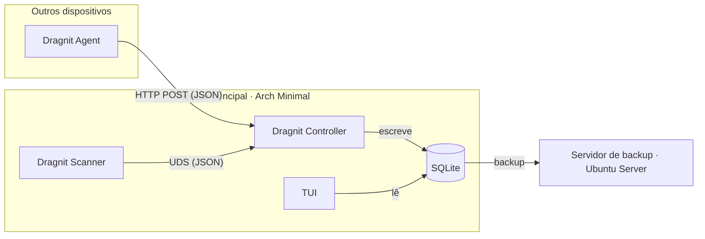

<div align="center">

# 🐉 Dragnit

**Monitor de rede para o teu homelab: descobre dispositivos, recolhe métricas e guarda o histórico.**

[Rust](https://img.shields.io/badge/Rust-2021-orange?logo=rust) [Plataforma](https://img.shields.io/badge/Linux-Arch%20%7C%20Ubuntu-blue?logo=linux&logoColor=white) [Base de dados](https://img.shields.io/badge/SQLite-003B57?logo=sqlite&logoColor=white) [Estado](https://img.shields.io/badge/estado-em%20desenvolvimento-yellow)

</div>

---

## 📖 Sobre

O **Dragnit** descobre os dispositivos presentes numa rede local e junta duas fontes de informação:

- um **Scanner** que vê _tudo_ o que está na rede (PCs, telemóveis, relógios, IoT), mesmo sem software instalado;
- um **Agent** que, nas máquinas onde é instalado, envia informação detalhada (RAM, discos, temperaturas, sistema operativo).

Tudo é guardado numa base de dados **SQLite** num servidor central (um portátil antigo com Arch Linux Minimal), com backup periódico para um segundo servidor. Os dados são mostrados numa **TUI** pensada para ficar ligada a um monitor.

> ⚠️ **Estado do projeto:** em desenvolvimento ativo. Ainda não há uma versão estável. Consulta o [roadmap](#-roadmap).

---

## 🏗️ Arquitetura



|Componente|Corre em|Função|
|---|---|---|
|**Dragnit Scanner**|Servidor principal|Descobre dispositivos na rede (ARP, ICMP, DNS)|
|**Dragnit Controller**|Servidor principal|Recebe dados do Scanner e dos Agents e escreve na base de dados|
|**Dragnit Agent**|Outros dispositivos|Recolhe e envia informação da própria máquina|
|**TUI**|Servidor principal|Mostra o inventário e os detalhes num terminal|

### Decisões de desenho

- **Scanner e Controller são executáveis separados.** O Scanner precisa de `cap_net_raw` para o `arp-scan`; o Controller, que está exposto à rede, corre sem privilégios.
- **Comunicação local por Unix Domain Socket.** Não abre portas e as permissões ficam no ficheiro do socket.
- **Só o Controller escreve na base de dados**, o que evita conflitos de escrita.
- **Os dispositivos não são identificados só pelo IP**, que muda com o DHCP. O Agent usa um ID persistente e o match com o Scanner faz-se por MAC.

---

## ✨ Funcionalidades

### 🔍 Scanner

|Método|O que descobre|
|---|---|
|**ARP**|Endereço IP e endereço MAC|
|**DNS inverso**|Hostname|
|**ICMP / ARP**|Estado de deteção|

### 🤖 Agent

|Categoria|Informação enviada|
|---|---|
|🌡️ **Temperaturas**|CPU, GPU|
|🧠 **RAM**|Memória usada e total, swap usada e total|
|💾 **Discos**|Percentagem de utilização, tamanho total, sistema de ficheiros|
|🌐 **Rede**|IPv4 e IPv6|
|🖥️ **Sistema**|Nome do PC, sistema operativo, kernel|

---

## 📁 Estrutura do projeto

```
dragnit/
├── Cargo.toml
└── src/
    ├── lib.rs                  # Estruturas partilhadas (DeviceInfo, AgentInfo, ...)
    └── bin/
        ├── dragnit-agent.rs       # Corre nos dispositivos monitorizados
        ├── dragnit-scanner.rs     # Corre no servidor principal
        └── dragnit-controller.rs  # Corre no servidor principal
```

---

## 🚀 Instalação

### Requisitos

- [Rust](https://rustup.rs) (edição 2021 ou superior)
- Linux (o Scanner e o Controller dependem de ferramentas e sockets Unix)
- [`arp-scan`](https://github.com/royhills/arp-scan), só no Scanner

### Compilar

```bash
git clone https://github.com/<o-teu-utilizador>/dragnit.git
cd dragnit
cargo build --release
```

Os binários ficam em `target/release/`.

> 💡 Se o servidor for uma máquina fraca (por exemplo, um Atom com 1 GB de RAM), compila noutra máquina e copia os binários. Confirma a arquitetura do destino com `uname -m`.

### Permissões do Scanner

O `arp-scan` usa sockets raw. Em vez de correr o Scanner como root, dá-lhe só a capacidade necessária:

```bash
sudo setcap cap_net_raw+ep $(which arp-scan)
```

---

## ▶️ Utilização

> Os executáveis estão em desenvolvimento, por isso os comandos podem mudar.

**No servidor principal:**

```bash
./dragnit-controller   # recebe dados e escreve na base de dados
./dragnit-scanner      # descobre dispositivos e envia ao Controller
```

**Nos dispositivos a monitorizar:**

```bash
./dragnit-agent        # recolhe a informação da máquina
```

Para correr tudo como serviço e arrancar sozinho, está prevista a criação de unidades `systemd` (ver [roadmap](#-roadmap)).

---

## 🗺️ Roadmap

### Fase 1 — Scanner `0/8`

- [ ] Converter `arp_scan()` para devolver `Vec`
- [ ] Detetar automaticamente interface e sub-rede
- [ ] Resolver hostnames por DNS inverso
- [ ] Integrar a verificação ICMP
- [ ] Juntar resultados sem duplicados
- [ ] Definir estados e momentos das sondagens (_respondeu_, _não respondeu_, _não testado_)
- [ ] Melhorar erros, permissões e desempenho
- [ ] Testar o inventário final

### Fase 2 — Comunicação `0/5`

- [ ] Preparar a mensagem do Scanner (`ScannerReport` com `serde`)
- [ ] Criar o Controller mínimo
- [ ] Abrir um Unix Domain Socket
- [ ] Testar comunicação e recuperação de falhas
- [ ] Preparar o Listener dos Agents (TCP/HTTP com autenticação)

### Fase 3 — Identidade e base de dados `1/5`

- [ ] Criar o Device Manager
- [ ] Criar IDs persistentes nos Agents
- [ ] Desenhar o esquema SQLite
- [ ] Criar o Database Writer
- [ ] Implementar backups seguros

### Fase 4 — Operação e interface `0/3`

- [ ] Construir a TUI
- [ ] Executar automaticamente (serviços `systemd` e scans periódicos)
- [ ] Testar a recuperação (reinício, Agent desconectado, mudança de DHCP, restauro de backup)

---

## 🔒 Segurança e privacidade

- O Dragnit faz scans de rede. **Usa-o apenas em redes onde tens autorização.**
- Os dados recolhidos (hostnames, MACs, hardware) ficam na tua base de dados, no teu servidor.
- Os MACs de muitos telemóveis são aleatórios e mudam por rede, por isso não são usados como identificador de longo prazo.
- O endpoint que recebe os relatórios dos Agents deve exigir autenticação, e não deve ser exposto fora da rede local.

---

## 🤝 Contribuir

Sugestões e _pull requests_ são bem-vindos. Abre primeiro uma _issue_ a descrever a mudança que queres fazer.

---

## 📄 Licença

Ainda por definir. Adiciona um ficheiro `LICENSE` (por exemplo MIT ou Apache-2.0) antes de tornar o repositório público.